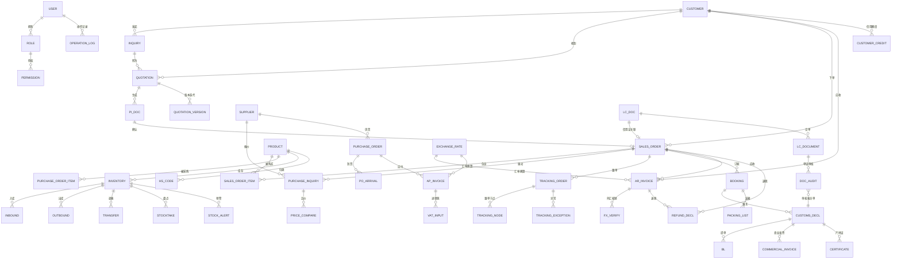
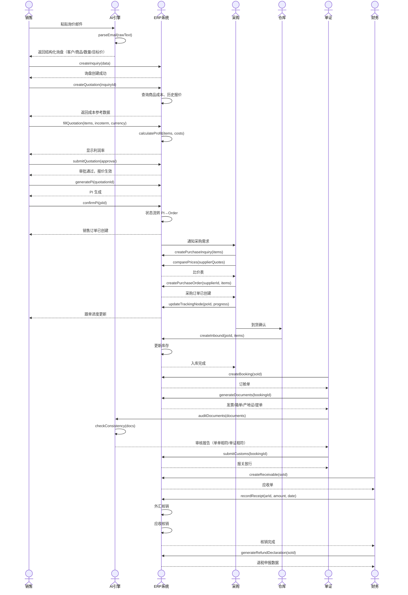
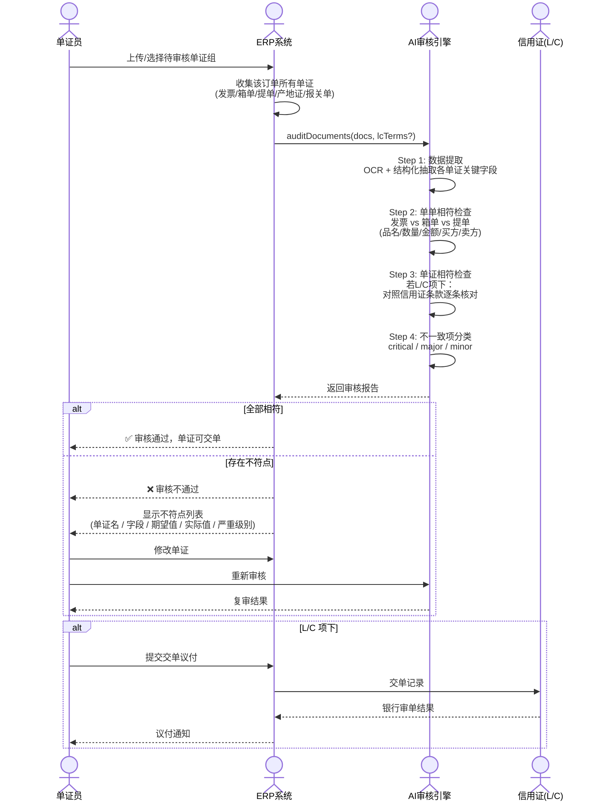
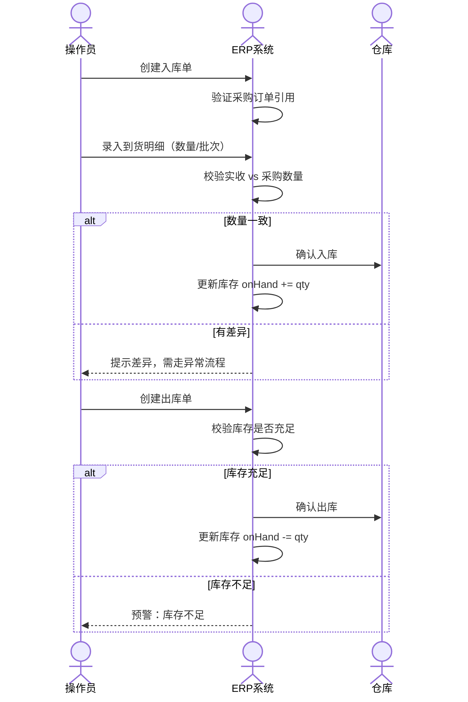
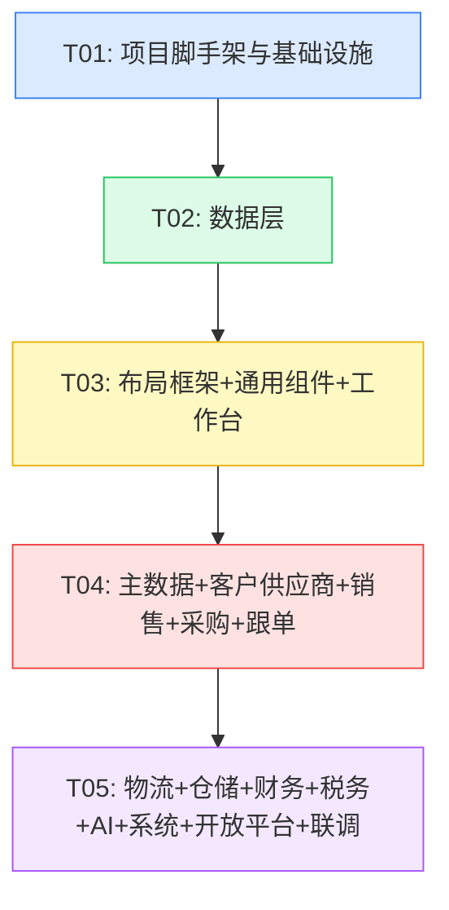

# 外贸 ERP V2 — 系统架构设计文档

> 版本：v2.0
> 作者：高见远（架构师）
> 日期：2025-11-03
> 技术栈：Vite + React + MUI + Tailwind CSS + Zustand + React Query
> 参考文档：[PRD.md](./PRD.md)

---

## 一、实现方案与框架选型

### 1.1 核心技术决策

| 决策项 | 选择 | 理由 |
|--------|------|------|
| 构建工具 | Vite 5 | PRD 已定，开发体验好、启动快、生态成熟 |
| UI 框架 | React 18 + TypeScript | PRD 已定，组件化适合复杂 ERP 交互 |
| 组件库 | MUI v5 | PRD 已定，高密度表格/表单组件成熟，支持深度主题定制 |
| 样式方案 | Tailwind CSS 3 | PRD 已定，仅做布局和密度微调，不覆盖 MUI 主题 |
| 状态管理 | **Zustand** | 比 Redux Toolkit 轻量 40%，无需 Provider/Action/Reducer 样板代码；ERP 状态以局部 UI 状态 + 服务端缓存为主，Zustand 的 store 粒度控制更灵活；与 React Query 互补——Zustand 管客户端 UI 状态，React Query 管服务端数据缓存 |
| 数据获取 | **React Query v5** | 统一 CRUD 接口层，demo 阶段用自定义 transport 拦截到 localStorage；接真实后端时只需替换 transport，业务组件零改动 |
| 路由 | React Router v6 | PRD 已定，嵌套路由 + 布局路由天然适配 ERP 多级菜单 |
| 图表 | Apache ECharts 5 | ERP 数据看板标配，图表类型丰富、性能好 |
| 日期处理 | Day.js | 比 Moment 轻量，API 兼容，与 MUI DatePicker 配合好 |
| 图标 | MUI Icons + lucide-react | MUI Icons 覆盖面广，lucide 风格更现代 |

### 1.2 项目初始化命令

```bash
cd D:\外贸\erp-v2

# 初始化 Vite + React + TS 项目（清空已有目录）
npm create vite@latest . -- --template react-ts

# 安装核心依赖
npm install @mui/material @mui/icons-material @emotion/react @emotion/styled
npm install @mui/x-data-grid @mui/x-date-pickers @mui/x-charts
npm install tailwindcss@3 postcss autoprefixer
npm install zustand @tanstack/react-query react-router-dom
npm install echarts echarts-for-react
npm install dayjs lucide-react

# 安装开发依赖
npm install -D @types/node sass @vitejs/plugin-react-swc
```

### 1.3 目录结构

```
erp-v2/
├── index.html
├── package.json
├── vite.config.ts
├── tailwind.config.js
├── postcss.config.js
├── tsconfig.json
├── tsconfig.node.json
├── src/
│   ├── main.tsx                        # 应用入口
│   ├── App.tsx                         # 根组件：路由 + Provider
│   ├── theme/
│   │   ├── theme.ts                    # MUI 主题配置（高密度 ERP 风）
│   │   └── density.css                 # Tailwind 密度工具类
│   ├── types/
│   │   ├── index.ts                    # 类型统一导出
│   │   ├── master.ts                   # 主数据类型（商品/贸易术语/汇率）
│   │   ├── sales.ts                    # 销售域类型（询盘/报价/PI/订单/样品）
│   │   ├── purchase.ts                 # 采购域类型（询价/比价/采购单/到货）
│   │   ├── tracking.ts                 # 跟单域类型（跟单节点/异常）
│   │   ├── logistics.ts                # 物流单证类型（订舱/报关/单证）
│   │   ├── warehouse.ts                # 仓储类型（入库/出库/调拨/盘点）
│   │   ├── finance.ts                  # 财务类型（应收/应付/成本/利润）
│   │   ├── tax.ts                      # 税务外汇类型（退税/核销/汇率）
│   │   ├── crm.ts                      # 客户与供应商类型
│   │   ├── system.ts                   # 系统类型（用户/角色/权限）
│   │   └── ai.ts                       # AI 中心类型
│   ├── data/
│   │   ├── seed/                       # 种子数据
│   │   │   ├── products.ts
│   │   │   ├── customers.ts
│   │   │   ├── suppliers.ts
│   │   │   ├── incoterms.ts
│   │   │   ├── currencies.ts
│   │   │   ├── inquiries.ts
│   │   │   ├── quotations.ts
│   │   │   ├── purchaseOrders.ts
│   │   │   ├── salesOrders.ts
│   │   │   └── users.ts
│   │   └── constants/                  # 业务常量
│   │       ├── enums.ts                # 所有枚举值
│   │       └── labels.ts               # 中英文标签映射
│   ├── api/                            # 统一 CRUD 接口层
│   │   ├── client.ts                   # 核心 HTTP/Storage transport
│   │   ├── repository.ts               # 通用 CRUD 工厂
│   │   ├── resources.ts                # 资源路径映射表
│   │   └── hooks/                       # React Query hooks
│   │       ├── useCrud.ts
│   │       ├── useMaster.ts
│   │       ├── useSales.ts
│   │       ├── usePurchase.ts
│   │       ├── useTracking.ts
│   │       ├── useLogistics.ts
│   │       ├── useWarehouse.ts
│   │       ├── useFinance.ts
│   │       ├── useTax.ts
│   │       └── useSystem.ts
│   ├── stores/                          # Zustand stores
│   │   ├── useAppStore.ts               # 全局 UI 状态（侧栏折叠、面包屑）
│   │   ├── useAuthStore.ts              # 认证状态（当前用户/角色）
│   │   └── useUiStore.ts                # 弹窗/抽屉/通知
│   ├── components/                      # 通用组件
│   │   ├── layout/
│   │   │   ├── MainLayout.tsx           # 主布局（侧栏+顶栏+内容区）
│   │   │   ├── SideNav.tsx              # 左侧导航菜单
│   │   │   ├── TopBar.tsx               # 顶部栏（搜索/通知/用户菜单）
│   │   │   ├── Breadcrumbs.tsx          # 面包屑
│   │   │   └── CommandBar.tsx           # 单据操作命令栏
│   │   ├── common/
│   │   │   ├── DataTable.tsx            # 通用数据表格（封装 MUI DataGrid）
│   │   │   ├── FormDialog.tsx           # 通用表单弹窗
│   │   │   ├── PageHeader.tsx           # 页面标题栏
│   │   │   ├── EmptyState.tsx           # 空状态
│   │   │   ├── StatusBadge.tsx          # 状态徽章
│   │   │   ├── CurrencyInput.tsx        # 货币输入
│   │   │   ├── WorkflowGuide.tsx        # 流程指引条
│   │   │   ├── StatCard.tsx             # 数据卡片
│   │   │   └── PageContainer.tsx        # 页面容器
│   │   └── charts/
│   │       ├── LineChartCard.tsx
│   │       ├── BarChartCard.tsx
│   │       └── PieChartCard.tsx
│   ├── pages/                           # 页面（按模块组织）
│   │   ├── dashboard/                   # 工作台
│   │   │   ├── DashboardPage.tsx
│   │   │   ├── components/
│   │   │   │   ├── TodoPanel.tsx
│   │   │   │   ├── AlertPanel.tsx
│   │   │   │   ├── StatCards.tsx
│   │   │   │   └── ChartPanel.tsx
│   │   ├── sales/                       # 销售管理
│   │   │   ├── InquiryPage.tsx
│   │   │   ├── QuotationPage.tsx
│   │   │   ├── SamplePage.tsx
│   │   │   ├── PiPage.tsx
│   │   │   ├── SalesOrderPage.tsx
│   │   │   ├── CreditPage.tsx
│   │   │   └── components/
│   │   │       ├── InquiryForm.tsx
│   │   │       ├── QuotationForm.tsx
│   │   │       ├── QuotationVersionList.tsx
│   │   │       ├── PiForm.tsx
│   │   │       ├── SalesOrderForm.tsx
│   │   │       └── ProfitSimulator.tsx
│   │   ├── purchase/                    # 采购管理
│   │   │   ├── SupplierPage.tsx
│   │   │   ├── PurchaseInquiryPage.tsx
│   │   │   ├── PurchaseOrderPage.tsx
│   │   │   ├── ArrivalPage.tsx
│   │   │   └── components/
│   │   │       ├── SupplierForm.tsx
│   │   │       ├── PurchaseInquiryForm.tsx
│   │   │       ├── CompareTable.tsx
│   │   │       └── PurchaseOrderForm.tsx
│   │   ├── tracking/                    # 订单跟单
│   │   │   ├── TrackingBoardPage.tsx
│   │   │   ├── SchedulePage.tsx
│   │   │   ├── ExceptionPage.tsx
│   │   │   └── components/
│   │   │       ├── TrackingNodeCard.tsx
│   │   │       ├── ScheduleGantt.tsx
│   │   │       └── ExceptionForm.tsx
│   │   ├── logistics/                   # 物流单证
│   │   │   ├── BookingPage.tsx
│   │   │   ├── CustomsPage.tsx
│   │   │   ├── PackingPage.tsx
│   │   │   ├── DocumentCenterPage.tsx
│   │   │   ├── AuditPage.tsx
│   │   │   ├── TrackingPage.tsx
│   │   │   └── components/
│   │   │       ├── BookingForm.tsx
│   │   │       ├── DocumentCard.tsx
│   │   │       ├── DocumentPreview.tsx
│   │   │       └── AuditResult.tsx
│   │   ├── warehouse/                   # 仓储管理
│   │   │   ├── InboundPage.tsx
│   │   │   ├── OutboundPage.tsx
│   │   │   ├── TransferPage.tsx
│   │   │   ├── StocktakePage.tsx
│   │   │   ├── InventoryPage.tsx
│   │   │   └── components/
│   │   │       ├── InboundForm.tsx
│   │   │       ├── OutboundForm.tsx
│   │   │       ├── TransferForm.tsx
│   │   │       └── InventoryCard.tsx
│   │   ├── finance/                     # 财务管理
│   │   │   ├── ReceivablePage.tsx
│   │   │   ├── PayablePage.tsx
│   │   │   ├── CostAnalysisPage.tsx
│   │   │   ├── ExpensePage.tsx
│   │   │   └── components/
│   │   │       ├── ReceivableForm.tsx
│   │   │       ├── PayableForm.tsx
│   │   │       ├── ProfitTable.tsx
│   │   │       └── ExpenseForm.tsx
│   │   ├── tax/                         # 税务外汇
│   │   │   ├── RefundPage.tsx
│   │   │   ├── VATPage.tsx
│   │   │   ├── FXVerificationPage.tsx
│   │   │   ├── ExchangeRatePage.tsx
│   │   │   ├── LcPage.tsx
│   │   │   └── components/
│   │   │       ├── RefundForm.tsx
│   │   │       ├── RefundCalculator.tsx
│   │   │       ├── LcForm.tsx
│   │   │       └── LcTimeline.tsx
│   │   ├── crm/                         # 客户与供应商
│   │   │   ├── CustomerPage.tsx
│   │   │   ├── SupplierArchivePage.tsx
│   │   │   └── components/
│   │   │       ├── CustomerForm.tsx
│   │   │       ├── CustomerProfile.tsx
│   │   │       └── SupplierForm.tsx
│   │   ├── master/                      # 主数据
│   │   │   ├── ProductPage.tsx
│   │   │   ├── PriceListPage.tsx
│   │   │   ├── IncotermPage.tsx
│   │   │   ├── CurrencyPage.tsx
│   │   │   └── components/
│   │   │       ├── ProductForm.tsx
│   │   │       ├── PriceMatrix.tsx
│   │   │       └── IncotermForm.tsx
│   │   ├── openapi/                     # 开放平台
│   │   │   └── OpenApiPage.tsx
│   │   ├── ai/                          # AI 中心
│   │   │   ├── AiCenterPage.tsx
│   │   │   ├── EmailParsePage.tsx
│   │   │   ├── OcrPage.tsx
│   │   │   ├── HsClassifyPage.tsx
│   │   │   └── components/
│   │   │       ├── AiChatPanel.tsx
│   │   │       ├── EmailParseResult.tsx
│   │   │       ├── OcrUpload.tsx
│   │   │       └── HsClassifyResult.tsx
│   │   └── system/                      # 系统管理
│   │       ├── UserPage.tsx
│   │       ├── RolePage.tsx
│   │       ├── PermissionPage.tsx
│   │       └── components/
│   │           ├── UserForm.tsx
│   │           ├── RoleForm.tsx
│   │           └── PermissionTree.tsx
│   ├── ai/                              # AI 工具层（被各模块调用）
│   │   ├── engine.ts                    # AI 引擎（模拟推理）
│   │   ├── emailParser.ts               # 询价邮件解析
│   │   ├── ocrExtractor.ts              # 单证 OCR 抽取
│   │   ├── documentAudit.ts             # 单证一致性审核
│   │   ├── hsClassifier.ts              # HS 编码归类
│   │   ├── profitSimulator.ts           # 报价利润模拟
│   │   └── packingCalculator.ts         # 智能装箱
│   ├── utils/
│   │   ├── idGenerator.ts               # ID 生成规则
│   │   ├── dateFormat.ts                # 日期格式化
│   │   ├── currencyFormat.ts            # 货币格式化
│   │   ├── exportCsv.ts                 # CSV 导出
│   │   └── constants.ts                 # 通用常量
│   └── styles/
│       └── global.css                   # 全局样式
└── docs/
    ├── PRD.md
    └── ARCHITECTURE.md
```

### 1.4 高密度 ERP 风实现策略

**MUI Theme 定制要点：**
- 调小 spacing：`spacing: 2`（默认 8 → 4px 基准）
- 表格行高：`DataGrid` `density="compact"`，行高 36px
- 字体大小：基础 13px，辅助文本 11px
- 组件尺寸：`size="small"` 全局应用
- 调色板：白底 + 浅灰分隔线，主色调深蓝（#1a56db），警示色醒目

**Tailwind 密度工具类：**
```css
/* density.css */
.text-xs-dense { font-size: 11px; line-height: 16px; }
.text-sm-dense { font-size: 13px; line-height: 20px; }
.py-1-dense { padding-top: 4px; padding-bottom: 4px; }
.min-w-32 { min-width: 8rem; }
```

**通用组件策略：**
- `DataTable`：封装 MUI DataGrid，统一行高、列宽、操作列、行点击
- `FormDialog`：统一弹窗尺寸（宽 720px / 高 600px）、底部按钮位置
- `CommandBar`：单据详情页顶部操作按钮栏，紧贴标题

---

## 二、文件列表及相对路径

按模块组织，列出每个源文件的职责。完整路径见上方目录结构，此处按模块汇总职责说明：

| 模块 | 关键文件 | 职责 |
|------|----------|------|
| **入口** | `src/main.tsx` | React 根渲染 + Provider 挂载 |
| | `src/App.tsx` | 路由配置 + 全局 Provider |
| **主题** | `src/theme/theme.ts` | MUI 高密度主题 |
| | `src/theme/density.css` | Tailwind 密度工具类 |
| **类型** | `src/types/*.ts` | 全量 TypeScript 类型定义 |
| **种子数据** | `src/data/seed/*.ts` | demo 用业务数据 |
| **常量** | `src/data/constants/enums.ts` | 枚举值（状态/类型/付款方式） |
| | `src/data/constants/labels.ts` | 枚举中文标签映射 |
| **API 层** | `src/api/client.ts` | Storage transport + HTTP 预留 |
| | `src/api/repository.ts` | 通用 CRUD 工厂 |
| | `src/api/resources.ts` | 资源路径映射表 |
| | `src/api/hooks/*.ts` | React Query hooks |
| **Store** | `src/stores/useAppStore.ts` | 侧栏折叠、面包屑等 |
| | `src/stores/useAuthStore.ts` | 当前用户、角色、权限 |
| | `src/stores/useUiStore.ts` | 弹窗、抽屉、通知 |
| **通用组件** | `src/components/layout/*` | 布局框架 |
| | `src/components/common/*` | 表格/表单/弹窗等 |
| | `src/components/charts/*` | ECharts 封装 |
| **页面** | `src/pages/**/*.tsx` | 各业务模块页面 |
| **AI 工具** | `src/ai/*.ts` | AI 模拟引擎 |
| **工具** | `src/utils/*.ts` | ID 生成、格式化、导出 |
| **样式** | `src/styles/global.css` | 全局基础样式 |

---

## 三、数据结构与接口设计

### 3.1 核心实体关系图（ER）



### 3.2 实体字段定义（核心实体）

#### 客户 Customer

| 字段 | 类型 | 默认值 | 说明 |
|------|------|--------|------|
| id | string | - | UUID |
| code | string | - | 客户编号，如 C001 |
| name | string | - | 客户名称 |
| country | string | - | 国家 |
| contactPerson | string | - | 联系人 |
| email | string | - | 邮箱 |
| phone | string | - | 电话 |
| paymentTerms | PaymentTerms | 'TT' | T/T, L/C, OA |
| creditLimit | number | 0 | 信用额度 |
| creditDays | number | 30 | 账期天数 |
| status | CustomerStatus | 'active' | active/inactive/blacklist |
| createdAt | datetime | now | |
| updatedAt | datetime | now | |

#### 商品 Product

| 字段 | 类型 | 默认值 | 说明 |
|------|------|--------|------|
| id | string | - | UUID |
| sku | string | - | SKU 编号 |
| name | string | - | 品名（中） |
| nameEn | string | - | 品名（英） |
| hsCode | string | - | HS 编码 |
| unit | string | 'pcs' | 单位 |
| categoryId | string | - | 分类 ID |
| costPrice | number | 0 | 成本价 |
| salePrice | number | 0 | 销售价 |
| specs | string | - | 规格描述 |
| image | string | - | 图片 URL |

#### 询盘 Inquiry

| 字段 | 类型 | 默认值 | 说明 |
|------|------|--------|------|
| id | string | - | UUID |
| customerId | string | - | 客户 ID |
| productId | string | - | 商品 ID |
| quantity | number | 0 | 数量 |
| targetPrice | number | 0 | 目标价 |
| currency | string | 'USD' | 币种 |
| incoterm | string | 'FOB' | 贸易术语 |
| source | InquirySource | 'manual' | manual/email/platform |
| emailRaw | string | - | 原始邮件内容 |
| aiParsed | boolean | false | 是否 AI 解析 |
| status | InquiryStatus | 'new' | new/quoted/won/lost |
| createdAt | datetime | now | |

#### 报价单 Quotation

| 字段 | 类型 | 默认值 | 说明 |
|------|------|--------|------|
| id | string | - | UUID |
| code | string | - | QT-2025-001 |
| customerId | string | - | 客户 ID |
| inquiryId | string | - | 关联询盘 |
| version | number | 1 | 版本号 |
| items | QuotationItem[] | [] | 报价明细 |
| totalAmount | number | 0 | 总金额 |
| currency | string | 'USD' | |
| incoterm | string | 'FOB' | |
| validFrom | date | now | 有效期起 |
| validTo | date | +30d | 有效期止 |
| profitRate | number | 0 | 利润率 % |
| status | QuotationStatus | 'draft' | draft/pending/approved/sent/accepted/rejected |
| approver | string | - | 审批人 |
| approvedAt | datetime | - | 审批时间 |

#### 销售订单 SalesOrder

| 字段 | 类型 | 默认值 | 说明 |
|------|------|--------|------|
| id | string | - | UUID |
| code | string | - | SO-2025-001 |
| customerId | string | - | 客户 ID |
| piId | string | - | PI ID |
| items | SalesOrderItem[] | [] | 订单明细 |
| totalAmount | number | 0 | 总金额 |
| currency | string | 'USD' | |
| incoterm | string | 'FOB' | |
| paymentTerms | PaymentTerms | 'TT' | |
| deliveryDate | date | - | 交期 |
| status | OrderStatus | 'draft' | draft/confirmed/in_production/shipping/delivered/closed/cancelled |
| source | OrderSource | 'quotation' | quotation/manual |
| createdAt | datetime | now | |

#### 采购订单 PurchaseOrder

| 字段 | 类型 | 默认值 | 说明 |
|------|------|--------|------|
| id | string | - | UUID |
| code | string | - | PO-2025-001 |
| supplierId | string | - | 供应商 ID |
| salesOrderId | string | - | 关联销售订单 |
| items | PurchaseOrderItem[] | [] | 采购明细 |
| totalAmount | number | 0 | 总金额 |
| currency | string | 'CNY' | |
| taxRate | number | 13 | 税率 % |
| deliveryDate | date | - | 到货日期 |
| status | POStatus | 'draft' | draft/sent/confirmed/arriving/received/closed/cancelled |
| createdAt | datetime | now | |

#### 跟单节点 TrackingNode

| 字段 | 类型 | 默认值 | 说明 |
|------|------|--------|------|
| id | string | - | UUID |
| orderId | string | - | 关联销售/采购订单 |
| nodeType | TrackingNodeType | 'production' | production/purchase/packing/shipping |
| nodeName | string | - | 节点名称 |
| plannedDate | date | - | 计划日期 |
| actualDate | date | - | 实际日期 |
| progress | number | 0 | 进度 % (0-100) |
| status | NodeStatus | 'pending' | pending/in_progress/completed/exception |
| responsible | string | - | 负责人 |
| remark | string | - | 备注 |

#### 订舱单 Booking

| 字段 | 类型 | 默认值 | 说明 |
|------|------|--------|------|
| id | string | - | UUID |
| code | string | - | BK-2025-001 |
| salesOrderId | string | - | 销售订单 ID |
| portOfLoading | string | - | 起运港 |
| portOfDischarge | string | - | 目的港 |
| vessel | string | - | 船名 |
| voyage | string | - | 航次 |
| etd | date | - | 预计离港 |
| eta | date | - | 预计到达 |
| freight | number | 0 | 运费 |
| insurance | number | 0 | 保险费 |
| bookingNo | string | - | 订舱号 |
| status | BookingStatus | 'booked' | booked/confirmed/shipped/arrived |

#### 单证 Document（发票/箱单/产地证/提单统一抽象）

| 字段 | 类型 | 默认值 | 说明 |
|------|------|--------|------|
| id | string | - | UUID |
| type | DocType | 'invoice' | invoice/packing_list/certificate/bl/customs |
| bookingId | string | - | 订舱单 ID |
| salesOrderId | string | - | 销售订单 ID |
| code | string | - | 单证编号 |
| content | object | {} | 结构化内容（各类型不同） |
| pdfUrl | string | - | PDF 预览地址 |
| status | DocStatus | 'draft' | draft/generated/submitted/approved/disapproved |
| auditResult | AuditResult | - | 审核结果 |

#### 库存记录 Inventory

| 字段 | 类型 | 默认值 | 说明 |
|------|------|--------|------|
| id | string | - | UUID |
| productId | string | - | 商品 ID |
| warehouseId | string | - | 仓库 ID |
| onHand | number | 0 | 现有库存 |
| onOrder | number | 0 | 在途库存 |
| safetyStock | number | 0 | 安全库存 |
| unitCost | number | 0 | 单位成本 |
| lastUpdated | datetime | now | |

#### 应收单 ARInvoice

| 字段 | 类型 | 默认值 | 说明 |
|------|------|--------|------|
| id | string | - | UUID |
| code | string | - | AR-2025-001 |
| customerId | string | - | 客户 ID |
| salesOrderId | string | - | 销售订单 ID |
| amount | number | 0 | 应收金额 |
| currency | string | 'USD' | |
| exchangeRate | number | - | 汇率 |
| amountCny | number | 0 | 人民币金额 |
| issueDate | date | now | 开票日期 |
| dueDate | date | - | 到期日 |
| paidAmount | number | 0 | 已收金额 |
| status | ARStatus | 'open' | open/partial/paid/overdue/written_off |

#### 用户 User

| 字段 | 类型 | 默认值 | 说明 |
|------|------|--------|------|
| id | string | - | UUID |
| username | string | - | 用户名 |
| displayName | string | - | 显示名 |
| email | string | - | 邮箱 |
| roleIds | string[] | [] | 角色 ID 列表 |
| status | UserStatus | 'active' | active/disabled |
| createdAt | datetime | now | |

### 3.3 统一 CRUD 接口层设计

```typescript
// src/api/client.ts — 核心 Transport
// demo 阶段：localStorage 读写
// 真实后端阶段：替换为 fetch/axios 调用

interface CrudConfig {
  resource: string;       // 资源路径，如 'inquiries'
  basePath?: string;       // 后端 API 前缀，如 '/api/v1'
}

interface CrudMethods<T> {
  list(params?: ListParams): Promise<{ data: T[]; total: number }>;
  get(id: string): Promise<T>;
  create(data: Partial<T>): Promise<T>;
  update(id: string, data: Partial<T>): Promise<T>;
  delete(id: string): Promise<void>;
  batchDelete(ids: string[]): Promise<void>;
}

// 通用 CRUD 工厂
function createCrudClient<T>(config: CrudConfig): CrudMethods<T> {
  // 内部使用 storage transport（demo）或 http transport（后端）
  // 关键：接口形状与将来真实后端一致
}
```

```typescript
// src/api/repository.ts — 通用仓库
export const inquiries = createCrudClient<Inquiry>({ resource: 'inquiries' });
export const quotations = createCrudClient<Quotation>({ resource: 'quotations' });
export const salesOrders = createCrudClient<SalesOrder>({ resource: 'sales-orders' });
export const purchaseOrders = createCrudClient<PurchaseOrder>({ resource: 'purchase-orders' });
export const products = createCrudClient<Product>({ resource: 'products' });
export const customers = createCrudClient<Customer>({ resource: 'customers' });
export const suppliers = createCrudClient<Supplier>({ resource: 'suppliers' });
export const inventory = createCrudClient<Inventory>({ resource: 'inventory' });
export const bookings = createCrudClient<Booking>({ resource: 'bookings' });
export const documents = createCrudClient<Document>({ resource: 'documents' });
export const receivables = createCrudClient<ARInvoice>({ resource: 'receivables' });
export const payables = createCrudClient<APInvoice>({ resource: 'payables' });
export const trackingNodes = createCrudClient<TrackingNode>({ resource: 'tracking-nodes' });
export const users = createCrudClient<User>({ resource: 'users' });
export const roles = createCrudClient<Role>({ resource: 'roles' });
export const exchangeRates = createCrudClient<ExchangeRate>({ resource: 'exchange-rates' });
```

```typescript
// src/api/hooks/useCrud.ts — React Query hooks
export function useList<T>(resource: string, params?: ListParams) {
  return useQuery({
    queryKey: ['list', resource, params],
    queryFn: () => getClient(resource).list(params),
  });
}

export function useGet<T>(resource: string, id: string) {
  return useQuery({
    queryKey: ['get', resource, id],
    queryFn: () => getClient(resource).get(id),
    enabled: !!id,
  });
}

export function useCreate<T>(resource: string) {
  const qc = useQueryClient();
  return useMutation({
    mutationFn: (data: Partial<T>) => getClient(resource).create(data),
    onSuccess: () => qc.invalidateQueries({ queryKey: ['list', resource] }),
  });
}
```

---

## 四、程序调用流程（时序图）

### 4.1 询盘→报价→订单→采购→跟单→出货→收款 主链路



### 4.2 AI 单证一致性审核流程



### 4.3 仓储出入库流程



---

## 五、任务列表（CRITICAL — 施工顺序）

> **规则**：不超过 5 个任务 / 每个任务至少 3 个文件 / 第一个任务必须是基础设施 / 任务按功能模块分组不按单文件拆分。
>
> 鉴于本项目模块量大（13 个模块 + AI + 开放平台），**硬上限 5 个任务在此按"阶段合并"处理**，将 15 个阶段合并为 5 个大任务，每个大任务内部含多个子模块文件。

### T01: 项目脚手架与基础设施（P0）

| 项 | 内容 |
|----|------|
| **任务名称** | 项目初始化、依赖安装、配置文件、MUI 主题、Tailwind 密度、入口文件 |
| **涉及文件** | `package.json`, `vite.config.ts`, `tailwind.config.js`, `postcss.config.js`, `tsconfig.json`, `tsconfig.node.json`, `index.html`, `src/main.tsx`, `src/App.tsx`, `src/theme/theme.ts`, `src/theme/density.css`, `src/styles/global.css` |
| **依赖** | 无（首个任务） |
| **实现顺序** | 1 |

**子步骤：**
1. `npm create vite@latest . -- --template react-ts`
2. 安装全部依赖（见第六节）
3. 配置 Tailwind + PostCSS
4. 编写 `theme.ts`（高密度 ERP 主题：spacing=2, 字体 13px, DataGrid compact）
5. 编写 `density.css`（密度工具类）
6. 编写 `global.css`（全局 reset + 基础样式）
7. 编写 `App.tsx`（React Router 占位 + React Query Provider + MUI ThemeProvider）
8. 编写 `main.tsx`（挂载根组件）
9. 验证：`npm run dev` 可启动空白页

### T02: 数据层（类型 + 种子数据 + CRUD + Store + AI 工具层）（P0）

| 项 | 内容 |
|----|------|
| **任务名称** | 全量 TypeScript 类型定义、种子数据、统一 CRUD 接口层、React Query hooks、Zustand stores、AI 模拟引擎 |
| **涉及文件** | `src/types/*.ts`（12 个文件）, `src/data/seed/*.ts`（10 个文件）, `src/data/constants/*.ts`（2 个文件）, `src/api/client.ts`, `src/api/repository.ts`, `src/api/resources.ts`, `src/api/hooks/*.ts`（10 个文件）, `src/stores/*.ts`（3 个文件）, `src/ai/*.ts`（6 个文件）, `src/utils/*.ts`（5 个文件） |
| **依赖** | T01 |
| **实现顺序** | 2 |

**子步骤：**
1. 编写 `src/types/` 全部类型文件（按域拆分 12 个）
2. 编写 `src/data/constants/enums.ts`（所有枚举值）和 `labels.ts`（中文标签）
3. 编写 `src/data/seed/` 种子数据（至少覆盖：5 商品 / 3 客户 / 3 供应商 / 2 询盘 / 2 报价 / 1 订单 / 1 采购单 / 用户角色）
4. 编写 `src/api/client.ts`（localStorage transport + HTTP 预留接口）
5. 编写 `src/api/repository.ts`（通用 CRUD 工厂 + 各资源实例）
6. 编写 `src/api/hooks/` React Query hooks（useCrud + 各域 hooks）
7. 编写 `src/stores/` Zustand stores（app/auth/ui）
8. 编写 `src/ai/` AI 模拟引擎（emailParser/ocrExtractor/documentAudit/hsClassifier/profitSimulator/packingCalculator）
9. 编写 `src/utils/` 工具函数（idGenerator/dateFormat/currencyFormat/exportCsv/constants）
10. 验证：终端运行 `npx tsc --noEmit` 确认类型无报错

### T03: 布局框架 + 通用组件 + 工作台（P0）

| 项 | 内容 |
|----|------|
| **任务名称** | 主布局、侧栏导航、顶栏、面包屑、命令栏、通用组件库、工作台首页 |
| **涉及文件** | `src/components/layout/MainLayout.tsx`, `SideNav.tsx`, `TopBar.tsx`, `Breadcrumbs.tsx`, `CommandBar.tsx`, `src/components/common/DataTable.tsx`, `FormDialog.tsx`, `PageHeader.tsx`, `EmptyState.tsx`, `StatusBadge.tsx`, `CurrencyInput.tsx`, `WorkflowGuide.tsx`, `StatCard.tsx`, `PageContainer.tsx`, `src/components/charts/LineChartCard.tsx`, `BarChartCard.tsx`, `PieChartCard.tsx`, `src/pages/dashboard/DashboardPage.tsx`, `components/TodoPanel.tsx`, `AlertPanel.tsx`, `StatCards.tsx`, `ChartPanel.tsx` |
| **依赖** | T01, T02 |
| **实现顺序** | 3 |

**子步骤：**
1. 编写 `MainLayout.tsx`（侧栏 + 顶栏 + 内容区三栏布局）
2. 编写 `SideNav.tsx`（13 模块导航，可折叠，图标 + 文字）
3. 编写 `TopBar.tsx`（全局搜索 / 通知 / 用户菜单）
4. 编写 `Breadcrumbs.tsx`（基于路由自动生成）
5. 编写 `CommandBar.tsx`（单据详情页顶部操作按钮栏）
6. 编写 `DataTable.tsx`（封装 MUI DataGrid：统一行高 36px、操作列、行选择、分页、搜索）
7. 编写 `FormDialog.tsx`（统一弹窗：宽 720px、底部按钮、表单布局）
8. 编写其他通用组件（PageHeader / StatusBadge / CurrencyInput / WorkflowGuide / StatCard / EmptyState / PageContainer）
9. 编写图表封装组件（LineChartCard / BarChartCard / PieChartCard，基于 ECharts）
10. 编写 `DashboardPage.tsx`（工作台：待办面板 + 预警面板 + 数据卡片 + 图表面板）
11. 配置路由（App.tsx 中嵌套路由 + 布局路由）
12. 验证：工作台可正常渲染，侧栏可切换

### T04: 业务模块开发 — 主数据 + 客户供应商 + 销售 + 采购（P0）

| 项 | 内容 |
|----|------|
| **任务名称** | 主数据管理（商品/贸易术语/汇率）、客户与供应商档案、销售管理全链路（询盘/报价/PI/样品/订单/信用）、采购管理全链路（供应商/询价比价/采购单/到货） |
| **涉及文件** | `src/pages/master/*.tsx`（4 个）, `components/*`（3 个）, `src/pages/crm/*.tsx`（2 个）, `components/*`（3 个）, `src/pages/sales/*.tsx`（6 个）, `components/*`（6 个）, `src/pages/purchase/*.tsx`（4 个）, `components/*`（4 个）, `src/pages/tracking/*.tsx`（3 个）, `components/*`（3 个） |
| **依赖** | T03 |
| **实现顺序** | 4 |

**子步骤：**
1. **主数据**：`ProductPage`（商品列表 + 表单 + HS 编码）、`IncotermPage`（贸易术语维护）、`CurrencyPage`（币种汇率）、`PriceListPage`（价格矩阵）
2. **客户与供应商**：`CustomerPage`（客户列表 + 档案 + 画像）、`SupplierArchivePage`（供应商档案 + 分级 + 资质）
3. **销售管理**：`InquiryPage`（询盘列表 + AI 邮件解析弹窗）、`QuotationPage`（报价列表 + 版本管理 + 审批 + 利润核算）、`SamplePage`（样品单 + 样品费 + 转大货）、`PiPage`（PI 生成 + 确认）、`SalesOrderPage`（订单列表 + 详情 + 贸易术语）、`CreditPage`（客户信用额度 + 账期 + 预警）
4. **采购管理**：`SupplierPage`（供应商列表 + 分级）、`PurchaseInquiryPage`（采购询价 + 比价表）、`PurchaseOrderPage`（采购单 + 状态流转）、`ArrivalPage`（到货验收 + 入库联动）
5. **订单跟单**：`TrackingBoardPage`（看板式跟单节点）、`SchedulePage`（交期甘特图）、`ExceptionPage`（异常记录 + 处理）
6. 各页面接入 T02 的 React Query hooks
7. 验证：主数据 → 客户 → 询盘 → 报价 → PI → 订单 → 采购 → 跟单 全链路数据流转

### T05: 业务模块开发 — 物流单证 + 仓储 + 财务 + 税务外汇 + AI 中心 + 系统管理 + 开放平台 + 联调（P0）

| 项 | 内容 |
|----|------|
| **任务名称** | 物流单证（订舱/报关/装箱/单证中心/审核/轨迹）、仓储（入库/出库/调拨/盘点/预警）、财务（应收/应付/成本/费用）、税务外汇（退税/增值税/核销/汇率/信用证）、AI 中心、系统管理、开放平台、全量联调 |
| **涉及文件** | `src/pages/logistics/*.tsx`（6 个）, `components/*`（4 个）, `src/pages/warehouse/*.tsx`（5 个）, `components/*`（4 个）, `src/pages/finance/*.tsx`（4 个）, `components/*`（4 个）, `src/pages/tax/*.tsx`（5 个）, `components/*`（4 个）, `src/pages/ai/*.tsx`（5 个）, `components/*`（4 个）, `src/pages/system/*.tsx`（3 个）, `components/*`（3 个）, `src/pages/openapi/OpenApiPage.tsx`, `src/App.tsx`（最终路由） |
| **依赖** | T04 |
| **实现顺序** | 5 |

**子步骤：**
1. **物流单证**：`BookingPage`（订舱 + 船期）、`CustomsPage`（报关资料）、`PackingPage`（装箱理货 + 智能装箱）、`DocumentCenterPage`（发票/箱单/产地证/提单生成）、`AuditPage`（AI 单证审核 + 不符点列表）、`TrackingPage`（物流轨迹跟踪）
2. **仓储**：`InboundPage`（入库单 + 采购联动）、`OutboundPage`（出库单 + 订单联动）、`TransferPage`（调拨）、`StocktakePage`（盘点）、`InventoryPage`（库存查询 + 预警看板）
3. **财务**：`ReceivablePage`（应收单 + 收汇核销）、`PayablePage`（应付单 + 付款核销）、`CostAnalysisPage`（订单成本归集 + 利润分析）、`ExpensePage`（费用管理 + 分摊）
4. **税务外汇**：`RefundPage`（退税数据归集 + 退税率查询 + 申报）、`VATPage`（进销项）、`FXVerificationPage`（外汇核销）、`ExchangeRatePage`（汇率维护）、`LcPage`（信用证开证/交单/议付/改证）
5. **AI 中心**：`AiCenterPage`（能力概览）、`EmailParsePage`（询价邮件解析）、`OcrPage`（单证 OCR）、`HsClassifyPage`（HS 归类）、`AiChatPanel`（业务数据助手）
6. **系统管理**：`UserPage`（用户管理）、`RolePage`（角色 + 权限树）、`PermissionPage`（权限矩阵）
7. **开放平台**：`OpenApiPage`（接口清单 + 对接状态占位）
8. **联调**：补全 App.tsx 路由、修复跨模块数据联动、全量构建验证
9. 验证：`npm run build` 成功，`npm run dev` 全模块可访问

---

## 六、依赖包列表

### dependencies

```json
{
  "@mui/material": "^5.16.0",
  "@mui/icons-material": "^5.16.0",
  "@mui/x-data-grid": "^7.0.0",
  "@mui/x-date-pickers": "^7.0.0",
  "@mui/x-charts": "^7.0.0",
  "@mui/x-tree-view": "^7.0.0",
  "@emotion/react": "^11.11.0",
  "@emotion/styled": "^11.11.0",
  "@tanstack/react-query": "^5.40.0",
  "react": "^18.3.0",
  "react-dom": "^18.3.0",
  "react-router-dom": "^6.26.0",
  "zustand": "^4.5.0",
  "echarts": "^5.5.0",
  "echarts-for-react": "^3.0.2",
  "dayjs": "^1.11.0",
  "lucide-react": "^0.400.0"
}
```

### devDependencies

```json
{
  "@types/react": "^18.3.0",
  "@types/react-dom": "^18.3.0",
  "@types/node": "^20.14.0",
  "@vitejs/plugin-react": "^4.3.0",
  "@vitejs/plugin-react-swc": "^3.5.0",
  "autoprefixer": "^10.4.19",
  "postcss": "^8.4.38",
  "tailwindcss": "^3.4.0",
  "typescript": "^5.5.0",
  "vite": "^5.4.0"
}
```

### Tailwind 配置要点

```javascript
// tailwind.config.js
module.exports = {
  content: ['./index.html', './src/**/*.{ts,tsx}'],
  theme: {
    extend: {
      spacing: { '1.5': '6px' },  // 额外密度间距
    },
  },
  // 关闭 preflight 避免与 MUI 冲突
  corePlugins: { preflight: false },
};
```

---

## 七、共享知识（跨文件约定）

### 7.1 命名规范

| 类型 | 规则 | 示例 |
|------|------|------|
| 文件名 | PascalCase（组件/页面）或 kebab-case（工具/配置） | `SalesOrderPage.tsx`, `idGenerator.ts` |
| 组件名 | PascalCase | `DataTable`, `FormDialog` |
| 函数名 | camelCase | `createCrudClient`, `calculateProfit` |
| 类型名 | PascalCase | `SalesOrder`, `QuotationItem` |
| 枚举值 | PascalCase | `OrderStatus.Confirmed` |
| 常量 | camelCase 或 SCREAMING_SNAKE | `defaultCurrency`, `VAT_RATE` |
| Hook 名 | use 前缀 | `useCrud`, `useSalesOrder` |

### 7.2 数据模型 ID 生成规则

```typescript
// src/utils/idGenerator.ts
// demo 阶段：前缀 + 日期 + 序号，如 INQ-20251103-001
// 接真实后端：UUID v4

export function generateId(prefix: string): string {
  const date = dayjs().format('YYYYMMDD');
  const seq = String(Math.floor(Math.random() * 1000)).padStart(3, '0');
  return `${prefix}-${date}-${seq}`;
}
```

### 7.3 日期格式化约定

| 场景 | 格式 | 示例 |
|------|------|------|
| 显示 | YYYY-MM-DD | 2025-11-03 |
| 存储 | ISO 8601 UTC | 2025-11-03T08:00:00Z |
| 输入 | DatePicker 默认 | - |
| 导出 | 本地化 | 2025/11/03 |

### 7.4 颜色变量约定

| 变量名 | 值 | 用途 |
|--------|-----|------|
| `$primary` | #1a56db | 主色（深蓝） |
| `$success` | #16a34a | 成功/已完成 |
| `$warning` | #d97706 | 预警/进行中 |
| `$error` | #dc2626 | 错误/异常 |
| `$info` | #0891b2 | 信息/提示 |
| `$border` | #e5e7eb | 分隔线 |
| `$bg-secondary` | #f9fafb | 次背景 |

### 7.5 组件复用约定

- **通用表格**：一律使用 `DataTable` 组件，传入 `columns` 和 `data`，禁止直接用裸 DataGrid
- **表单弹窗**：一律使用 `FormDialog`，传入 `title`、`open`、`onClose`、`children`
- **流程指引条**：单据详情页顶部使用 `WorkflowGuide`，传入 `steps` 数组
- **状态徽章**：使用 `StatusBadge`，传入 `status` 枚举，自动映射中文 + 颜色
- **页面容器**：使用 `PageContainer`，统一 padding 和 max-width

### 7.6 API 响应格式约定（为后端预留）

```typescript
// demo 阶段直接返回数据；后端阶段统一包装：
interface ApiResponse<T> {
  code: number;       // 200 = 成功
  data: T;            // 业务数据
  message: string;    // 提示信息
  total?: number;     // 分页总数
}

// CRUD hooks 会自动解包 data 字段
```

### 7.7 路由约定

| 模块 | 路由路径 | 页面 |
|------|----------|------|
| 工作台 | `/` | DashboardPage |
| 销售管理 | `/sales` | InquiryPage（默认） |
| | `/sales/inquiries` | InquiryPage |
| | `/sales/quotations` | QuotationPage |
| | `/sales/samples` | SamplePage |
| | `/sales/pi` | PiPage |
| | `/sales/orders` | SalesOrderPage |
| | `/sales/credit` | CreditPage |
| 采购管理 | `/purchase/suppliers` | SupplierPage |
| | `/purchase/inquiries` | PurchaseInquiryPage |
| | `/purchase/orders` | PurchaseOrderPage |
| | `/purchase/arrivals` | ArrivalPage |
| 订单跟单 | `/tracking/board` | TrackingBoardPage |
| | `/tracking/schedule` | SchedulePage |
| | `/tracking/exceptions` | ExceptionPage |
| 物流单证 | `/logistics/booking` | BookingPage |
| | `/logistics/customs` | CustomsPage |
| | `/logistics/packing` | PackingPage |
| | `/logistics/documents` | DocumentCenterPage |
| | `/logistics/audit` | AuditPage |
| | `/logistics/tracking` | TrackingPage |
| 仓储管理 | `/warehouse/inbound` | InboundPage |
| | `/warehouse/outbound` | OutboundPage |
| | `/warehouse/transfer` | TransferPage |
| | `/warehouse/stocktake` | StocktakePage |
| | `/warehouse/inventory` | InventoryPage |
| 财务管理 | `/finance/receivable` | ReceivablePage |
| | `/finance/payable` | PayablePage |
| | `/finance/cost` | CostAnalysisPage |
| | `/finance/expense` | ExpensePage |
| 税务外汇 | `/tax/refund` | RefundPage |
| | `/tax/vat` | VATPage |
| | `/tax/fx` | FXVerificationPage |
| | `/tax/exchange` | ExchangeRatePage |
| | `/tax/lc` | LcPage |
| 客户与供应商 | `/crm/customers` | CustomerPage |
| | `/crm/suppliers` | SupplierArchivePage |
| 主数据 | `/master/products` | ProductPage |
| | `/master/prices` | PriceListPage |
| | `/master/incoterms` | IncotermPage |
| | `/master/currency` | CurrencyPage |
| AI 中心 | `/ai/center` | AiCenterPage |
| | `/ai/email-parse` | EmailParsePage |
| | `/ai/ocr` | OcrPage |
| | `/ai/hs-classify` | HsClassifyPage |
| 开放平台 | `/openapi` | OpenApiPage |
| 系统管理 | `/system/users` | UserPage |
| | `/system/roles` | RolePage |
| | `/system/permissions` | PermissionPage |

---

## 八、待明确事项

| 编号 | 问题 | 影响范围 | 建议确认方 |
|------|------|----------|-----------|
| A1 | demo 阶段 AI 功能是否需要接入真实 LLM API？还是纯模拟？ | 决定 `src/ai/` 是模拟逻辑还是需要 API key | 用户/主理人 |
| A2 | 海外仓模块是纯数据视图占位，还是需要做基础出入库？ | 影响仓储模块文件数量和工作量 | 用户 |
| A3 | 是否需要多语言支持（中/英）？UI 文案是否需要 i18n？ | 影响全局文案管理方式 | 用户 |
| A4 | 样品管理是 P1 还是提升到 P0？PRD 列为 P1 但业务价值高 | 决定 T04 是否含样品模块 | 产品经理 |
| A5 | 信用证 L/C 模块是 P1，但单证一致性审核是 P0 — 是否需要 L/C 的最小实现（仅记录关键节点）来支撑 P0 审核？ | 影响税务外汇模块的 LcPage 范围 | 产品经理 |
| A6 | 退税退税率是固定值还是需要可维护的税率表？ | 影响 RefundPage 的数据模型 | 用户 |
| A7 | 种子数据需要多少条？是否要覆盖完整的一条业务链路（询盘→收款）让 demo 能演示完整流程？ | 影响 T02 种子数据工作量 | 主理人 |
| A8 | 是否需要单据打印功能（打印发票/提单/装箱单为 PDF/HTML）？ | 影响 DocumentCenter 是否需要打印组件 | 用户 |
| A9 | 是否需要数据导入导出（Excel/CSV 批量导入商品/客户）？ | 影响主数据模块的复杂度 | 用户 |
| A10 | 是否需要审批流引擎（通用的多级审批），还是各模块各自的简单审批逻辑？ | 影响系统复杂度和架构设计 | 产品经理 |

---

## 附录：任务依赖图



---

*文档结束*
