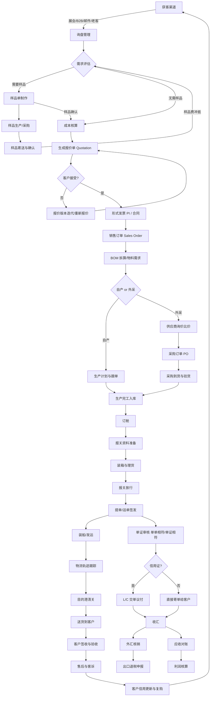
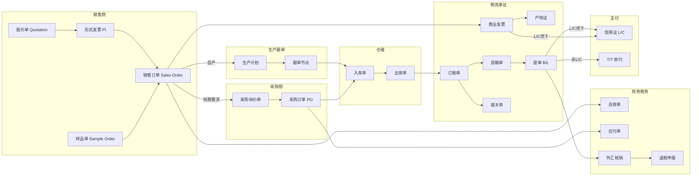
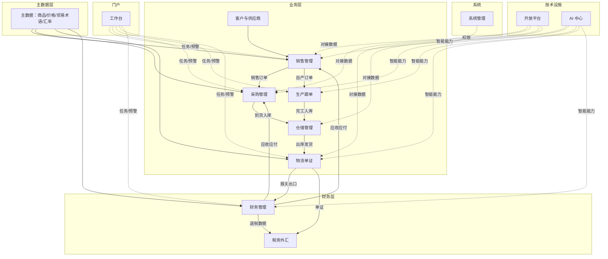
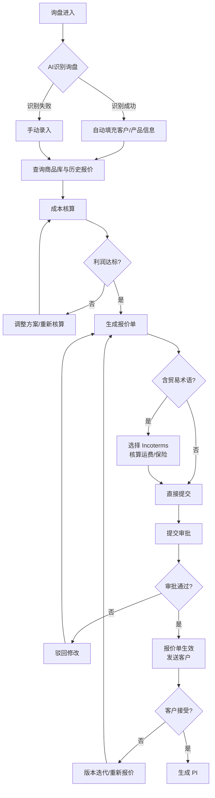
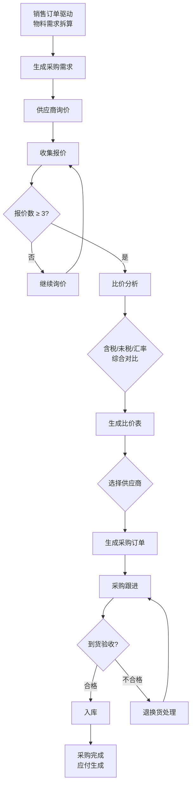
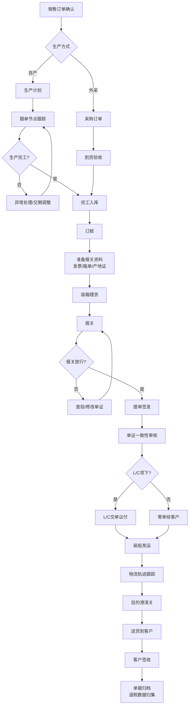
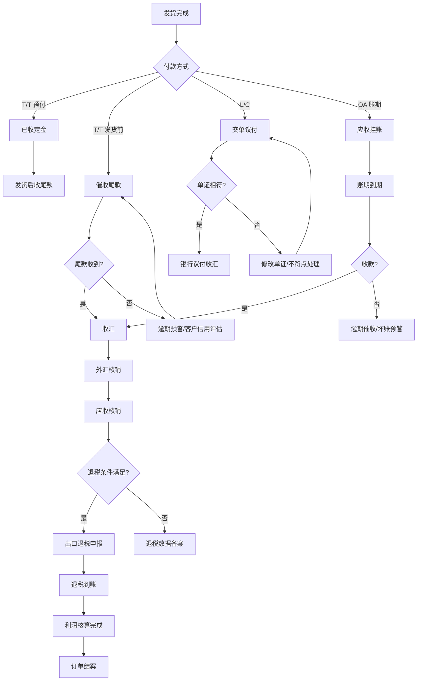

# 外贸 ERP V2 产品需求文档（PRD）

> 版本：v2.0
> 作者：许清楚（产品经理）
> 日期：2025-11-03
> 技术栈：React + MUI + Tailwind CSS
> UI 风格：高密度专业 ERP 风（信息密度高、表格为主、贴近真实 ERP 操作习惯）

---

## 0. 文档说明

本文档基于"从业务本质重新审视"的原则，对 V1 的 11 个模块进行全面批判性审视后重新规划。核心立场：**V1 模块数量合理但业务流程断点明显、外贸特有环节缺失严重，重做时应以业务闭环为主线重组模块，而非在原有模块上修补。**

---

## 一、业务逻辑合理性探讨

### 1.1 外贸出口业务完整闭环

以下流程图覆盖从获客到收款退税的完整外贸出口业务闭环：



### 1.2 V1 流程断点与缺失分析

| 编号 | V1 断点/缺失环节 | 说明 | 业务影响 |
|------|------------------|------|----------|
| BP-1 | **样品环节整体缺失** | V1 从询价直接跳到订单，无样品单、样品费、样品转大货流程 | 样品是外贸高频环节，尤其新品/大额订单，缺失导致业务衔接断裂 |
| BP-2 | **贸易术语 Incoterms 缺失** | FOB/CIF/DDP/EXW/FCA 等未在报价和订单中结构化处理 | 贸易术语决定运费/保险/报关责任归属，缺失则成本核算错误、责任不清 |
| BP-3 | **PI/形式发票与合同环节缺失** | 报价单到销售订单之间缺 PI/合同中间环节 | PI 是客户确认下单的法律依据，也是 L/C 开证基础 |
| BP-4 | **信用证 L/C 全流程缺失** | V1 仅在"支付对接"中一笔带过，无开证、交单、议付、改证流程 | L/C 是大额订单常用支付方式，缺失则无法承接 L/C 订单 |
| BP-5 | **出口退税缺失** | 完全未涉及 | 出口退税是外贸企业核心利润来源，缺失导致利润核算失真、税务风险 |
| BP-6 | **外汇核销缺失** | 收汇后无外汇核销环节 | 国家外汇管理合规要求，缺失有合规风险 |
| BP-7 | **单证一致性审核缺失** | 无"单单相符/单证相符"审核机制 | L/C 项下单证不符会被银行拒付，造成资金损失和信誉风险 |
| BP-8 | **运费保险成本归集缺失** | 物流模块只管订舱，未把运费/保险费计入报价和成本 | 报价利润失真，CIF/DDP 条款下成本漏算 |
| BP-9 | **报价版本与审批流脱节** | 报价版本管理存在，但缺审批流和利润红线控制 | 销售乱报价、亏本报价无法拦截 |
| BP-10 | **贸易合规审查缺失** | 无制裁名单筛查、出口管制、产品认证环节 | 有法规合规风险（如 OFAC 制裁、出口管制清单） |
| BP-11 | **退运/返修流程缺失** | 无退运、返修业务处理 | 海外客户退运是真实业务，缺失则异常场景无法闭环 |

### 1.3 单据上下游依赖关系



**关键依赖规则**：
- 报价单 → PI → 销售订单：报价确认后必须生成 PI，PI 确认后才能转销售订单，保证业务可追溯
- 销售订单 → 采购订单：销售订单是采购的源头，采购数量应考虑库存+在途+已采购
- 销售订单 → 商业发票：发票金额必须与 PI/销售订单一致（单单相符）
- 提单 → 外汇核销 → 退税：报关出口后才有退税资格，退税以报关单+收汇为前提

---

## 二、功能完整性审视

### 2.1 V1 缺失环节重要度评级

| 缺失环节 | 重要度 | 理由 |
|----------|--------|------|
| **出口退税** | 🔴 高 | 外贸企业核心利润来源（退税率通常 9%-17%），缺失导致利润核算失真、税务违规风险 |
| **信用证 L/C 全流程** | 🔴 高 | 大额订单/新客户常用支付方式，缺失则无法承接 L/C 订单，丢单风险 |
| **贸易术语 Incoterms** | 🔴 高 | 决定运费/保险/报关责任归属，影响报价和成本核算准确性，无法绕开 |
| **外汇核销与收付汇** | 🔴 高 | 国家外汇管理合规要求，收汇后必须核销，缺失有合规风险 |
| **样品管理** | 🔴 高 | 外贸高频环节（尤其新品/大额订单），样品费/样品转大货是真实业务流程 |
| **单证一致性审核** | 🔴 高 | L/C 项下单证不符会被银行拒付，造成资金损失，必须严格审核 |
| **PI/形式发票与合同** | 🔴 高 | PI 是客户下单的法律依据和 L/C 开证基础，缺少则订单无凭据 |
| **客户信用管理** | 🟡 中 | B2B 大额业务需要账期管理、坏账预警，但可通过线下或轻量实现 |
| **汇率换算与多币种** | 🟡 中 | 外贸多币种核算必需，但属基础财务能力，实现难度不高 |
| **增值税进销项管理** | 🟡 中 | 进项抵扣影响成本核算，但可与税务系统对接，非 ERP 核心 |
| **报关单证管理**（产地证等） | 🟡 中 | 单证员常规工作，可部分线下处理，但结构化管理能提升效率 |
| **贸易合规审查** | 🟡 中 | 制裁名单/出口管制有法规风险但非高频，可作为风控模块增值功能 |
| **退运/返修流程** | 🟢 低 | 低频异常场景，但应有基本处理能力，优先级靠后 |

### 2.2 V1 已有但需加强的功能

| 功能 | V1 现状 | 需加强点 |
|------|----------|----------|
| 报价版本管理 | 有 | 需增加审批流、利润红线、贸易术语结构化 |
| 采购比价 | 有 | 需增加供应商分级、历史价格对比、含税/未税价 |
| 跟单节点 | 有 | 需与生产计划、采购到货、订舱环节联动，而非独立 |
| 物流信息管理 | 有 | 需增加运费/保险成本归集、单证生成 |
| 库存预警 | 有 | 需区分国内仓/海外仓，增加安全库存、在途库存 |
| 应收应付 | 有 | 需增加账期、信用额度、坏账预警、汇率换算 |
| 基础资料管理 | 有 | 需增加商品归类（HS 编码）、贸易术语主数据 |

---

## 三、模块划分合理性

### 3.1 V1 模块划分问题诊断

| V1 模块 | 问题 | 判断 |
|---------|------|------|
| 海外客户询价、报价及报价版本管理 | 与"客户订单/销售订单"割裂，缺少 PI/合同环节 | ❌ 应合并为"销售管理" |
| 供应商询价、比价、采购订单及采购进度 | 模块合理，但缺供应商分级和资质管理 | ⚠️ 保留并增强 |
| 客户订单、销售订单及采购订单关联 | 订单管理与销售管理割裂，逻辑上应同属销售侧 | ❌ 并入"销售管理" |
| 跟单节点、交期、异常情况及任务提醒 | 跟单是贯穿销售-采购-生产-出货的横向能力，不应独立成模块 | ❌ 拆散并入各业务模块 + 工作台 |
| 订舱、报关、装箱、出货及物流信息管理 | 模块过大，报关单证/单证审核/L/C 单证应独立 | ⚠️ 拆分为"物流单证"+"仓储" |
| 海外仓入库、出库、调拨、盘点及库存预警 | 合理，但缺国内仓，应统称"仓储管理" | ⚠️ 扩展为国内+海外仓 |
| 应收、应付、成本、利润及业务数据统计 | 缺税务（退税/增值税）和外汇，财务模块不完整 | ❌ 拆为"财务管理"+"税务外汇" |
| 客户、供应商、商品、价格等基础资料管理 | 基础资料合理，但缺贸易术语、HS编码、汇率等外贸主数据 | ⚠️ 扩展主数据范围 |
| ERP 与第三方平台对接 | 作为模块不合理，是技术能力非业务模块 | ❌ 改为"开放平台"技术设施 |
| AI 应用 | 作为模块不合理，AI 是横切能力应嵌入各业务模块 | ❌ 改为"AI 中心"技术设施 |
| 用户权限体系 | 合理 | ✅ 保留为"系统管理" |

### 3.2 建议的 V2 模块结构

```
外贸 ERP V2 模块树
│
├── 1. 工作台（个人门户）
│   ├── 我的待办与任务提醒
│   ├── 业务预警看板
│   └── 个人数据卡片
│
├── 2. 销售管理
│   ├── 询盘管理
│   ├── 报价管理（含版本/审批/贸易术语）
│   ├── 样品管理（样品单/样品费/样品转大货）
│   ├── PI/合同管理
│   ├── 销售订单管理
│   └── 客户信用管理
│
├── 3. 采购管理
│   ├── 供应商管理（分级/资质）
│   ├── 采购询价与比价
│   ├── 采购订单管理
│   └── 采购到货与验收
│
├── 4. 生产跟单
│   ├── 生产计划
│   ├── 跟单节点跟踪
│   ├── 交期管理
│   └── 异常管理
│
├── 5. 物流单证
│   ├── 订舱管理
│   ├── 报关管理
│   ├── 装箱理货
│   ├── 单证中心（发票/箱单/产地证/提单）
│   ├── 单证一致性审核
│   └── 物流轨迹跟踪
│
├── 6. 仓储管理
│   ├── 国内仓管理
│   ├── 海外仓管理
│   ├── 入库/出库/调拨/盘点
│   └── 库存预警
│
├── 7. 财务管理
│   ├── 应收管理
│   ├── 应付管理
│   ├── 成本核算与利润分析
│   └── 费用管理
│
├── 8. 税务外汇
│   ├── 出口退税管理
│   ├── 增值税管理
│   ├── 外汇核销
│   └── 汇率管理
│
├── 9. 客户与供应商（CRM + 供应商档案）
│   ├── 客户档案与画像
│   ├── 客户跟进与商机
│   └── 供应商档案
│
├── 10. 主数据
│   ├── 商品管理（含 HS 编码）
│   ├── 价格体系管理
│   ├── 贸易术语主数据
│   └── 汇率与币种
│
├── 11. 开放平台（技术设施）
│   ├── 电商平台对接
│   ├── 海外仓对接
│   ├── 物流对接
│   ├── 支付对接
│   ├── 邮件对接
│   └── API 管理
│
├── 12. AI 中心（技术设施）
│   ├── AI 能力服务
│   └── AI 配置管理
│
└── 13. 系统管理
    ├── 用户与权限
    ├── 组织与角色
    └── 系统配置
```

### 3.3 模块间信息流转图



**模块职责边界说明**：
- **销售管理**：覆盖从询盘到销售订单的全销售侧流程，是业务起点
- **采购管理**：只负责采购侧，采购需求由销售订单驱动
- **生产跟单**：仅管理自产业务的生产计划与跟单，外采不在此模块
- **物流单证**：管出货侧所有单据和报关，但不含仓储内部操作
- **仓储管理**：只管库存实物，不含销售和采购
- **财务管理**：只管钱（应收应付成本利润），不含税务和外汇合规
- **税务外汇**：只管税务和外汇合规，是财务的延伸但专业性强故独立
- **开放平台/AI 中心**：技术设施，不直接产生业务数据，为业务模块赋能

---

## 四、AI 应用落地性分析

### 4.1 V1 七项 AI 能力评估

| AI 能力 | 真实业务价值 | 落地难度 | 建议优先级 | 判断与理由 |
|----------|-------------|----------|-----------|-----------|
| 询价邮件识别 | 🟢 高 | 🟢 低 | P0 | 真实痛点。外贸询盘邮件量大且非结构化，自动识别询盘、提取产品需求、客户信息能显著提效。技术成熟（NLP），落地容易 |
| 文档抽取（单证OCR） | 🟢 高 | 🟡 中 | P0 | 真实痛点。报关单、发票、提单等单证录入是单证员主要工作量，OCR+结构化抽取能大幅提效。难点在于单证版式多样 |
| 智能报价 | 🟡 中 | 🔴 高 | P2 | 噱头大于实效。报价核心是成本核算+利润策略，AI 难以替代人工决策。建议降级为"报价辅助"（自动调取历史价、成本估算），而非"智能报价" |
| 交期风险预警 | 🟡 中 | 🔴 高 | P1 | 有价值但难落地。交期受供应商/生产/物流多因素影响，AI 预测需大量历史数据，冷启动难。建议先做规则预警（交期临近未完工），再逐步引入 AI |
| 库存需求预测 | 🟡 中 | 🔴 高 | P2 | 价值有限。外贸库存受订单驱动，需求相对明确，预测价值不如零售。且需要大量历史数据，冷启动难。建议后置 |
| 翻译归类 | 🟡 中 | 🟢 低 | P1 | 部分真实价值。商品归类（HS 编码归类）是刚需，翻译需求也有。但归类准确率要求高，AI 辅助+人工确认是合理模式 |
| 知识库问答 | 🔴 低 | 🟢 低 | P1 | 噱头。通用知识库问答价值低，外贸场景更需要的是业务数据查询而非知识问答。建议降级为"业务数据助手"（如"查某客户历史订单"） |

### 4.2 判断结论

**真正解决痛点的 AI**：
- 询价邮件识别（P0）— 高频刚需，技术成熟
- 文档抽取/单证 OCR（P0）— 单证员核心工作量，ROI 明确

**噱头大于实效的 AI**：
- 智能报价 — 应降级为报价辅助
- 库存需求预测 — 外贸场景价值有限
- 知识库问答 — 应转型为业务数据助手

**有条件可落地的 AI**：
- 交期风险预警（P1）— 先做规则预警，数据积累后再引入 AI
- 翻译归类（P1）— AI 辅助+人工确认

### 4.3 建议补充的更有价值的 AI 应用

| AI 应用 | 价值 | 难度 | 优先级 | 理由 |
|----------|------|------|--------|------|
| **单证一致性智能审核** | 🔴 高 | 🟡 中 | P0 | L/C 项下必须单单相符/单证相符，人工审核易出错且耗时。AI 自动比对发票/箱单/提单/产地证，标注不符点，价值极高 |
| **客户风险画像** | 🟡 中高 | 🟡 中 | P1 | 通过公开数据（海关记录、工商信息）判断客户信用风险，坏账预警。外贸坏账损失大，价值高但数据获取有难度 |
| **智能装箱计算** | 🟡 中 | 🟡 中 | P1 | 计算最优装箱方案（体积/重量最大化利用），减少运费浪费。3D 装箱算法成熟，实用 |
| **报价利润模拟** | 🟡 中 | 🟢 低 | P1 | 不同贸易术语（FOB/CIF/DDP）下的利润测算，帮助销售选择最优条款。本质是规则计算，AI 价值不大但业务价值高 |
| **HS 编码智能归类** | 🟡 中 | 🟡 中 | P1 | 商品归类是报关刚需，错误归类导致退税损失或查验。AI 辅助归类+人工确认 |
| **业务数据助手** | 🟡 中 | 🟢 低 | P1 | "查某客户历史订单""本月利润"等业务数据查询，比通用知识库问答更有价值 |

---

## 五、PRD 正文

### 5.1 产品目标

| 目标 | 说明 | 衡量指标 |
|------|------|----------|
| **目标一：构建外贸出口全业务闭环** | 覆盖从获客到收款退税的完整业务链，消除 V1 断点 | 业务闭环覆盖率 ≥ 90%，单据衔接零断点 |
| **目标二：提升单证与财务处理效率** | 结构化管理报关单证、单证一致性审核、出口退税，降低人工错误和税务风险 | 单证录入效率提升 50%，退税申报准确率 ≥ 99% |
| **目标三：打造高密度专业 ERP 操作体验** | 信息密度高、表格为主、贴近真实 ERP 操作习惯 | 核心单据录入 ≤ 3 步，关键操作 ≤ 2 次点击 |

### 5.2 核心用户角色

| 角色 | 职责 | 核心使用模块 |
|------|------|-------------|
| 销售 | 询盘处理、报价、客户跟进、订单确认 | 销售管理、客户与供应商、工作台 |
| 采购 | 供应商询价比价、采购订单、到货跟进 | 采购管理、工作台 |
| 跟单 | 生产进度跟踪、交期管理、异常处理 | 生产跟单、工作台 |
| 单证 | 报关资料准备、单证制作、单证审核 | 物流单证、工作台 |
| 物流 | 订舱、物流跟踪、运费核算 | 物流单证、工作台 |
| 仓库 | 出入库、盘点、调拨、库存预警 | 仓储管理、工作台 |
| 财务 | 应收应付、成本核算、对账、退税 | 财务管理、税务外汇、工作台 |
| 管理层 | 业务数据统计、利润分析、经营决策 | 工作台、财务管理 |
| 系统管理员 | 用户权限、主数据维护、系统配置 | 系统管理、主数据 |

### 5.3 需求池（按优先级分级）

#### P0 - Must Have（V2 必须交付）

| 编号 | 需求 | 模块 | 优先级 | 说明 |
|------|------|------|--------|------|
| P0-01 | 询盘管理与询价邮件 AI 识别 | 销售管理 | P0 | 询盘录入、分类、跟进、AI 自动识别询盘邮件 |
| P0-02 | 报价管理（含贸易术语、版本、审批） | 销售管理 | P0 | 报价单含 Incoterms、币种、有效期、利润核算、审批流 |
| P0-03 | PI/形式发票管理 | 销售管理 | P0 | 报价确认后生成 PI，作为销售订单依据 |
| P0-04 | 销售订单管理 | 销售管理 | P0 | 销售订单含贸易术语、交期、付款方式 |
| P0-05 | 采购询价与比价 | 采购管理 | P0 | 供应商询价、比价、历史价格对比 |
| P0-06 | 采购订单管理 | 采购管理 | P0 | 采购订单含供应商、交期、价格、税率 |
| P0-07 | 供应商管理 | 采购管理 | P0 | 供应商档案、分级、资质管理 |
| P0-08 | 生产跟单与交期管理 | 生产跟单 | P0 | 跟单节点、交期提醒、异常处理 |
| P0-09 | 订舱与物流跟踪 | 物流单证 | P0 | 订舱管理、物流轨迹跟踪 |
| P0-10 | 单证中心（发票/箱单/产地证/提单） | 物流单证 | P0 | 结构化生成和管理核心报关单证 |
| P0-11 | 单证一致性审核 | 物流单证 | P0 | 单单相符/单证相符自动比对审核 |
| P0-12 | 仓储管理（国内+海外） | 仓储管理 | P0 | 出入库、调拨、盘点、库存预警 |
| P0-13 | 应收应付管理 | 财务管理 | P0 | 应收单、应付单、对账 |
| P0-14 | 成本核算与利润分析 | 财务管理 | P0 | 订单成本归集、利润核算 |
| P0-15 | 出口退税管理 | 税务外汇 | P0 | 退税数据归集、申报、退税率查询 |
| P0-16 | 外汇核销 | 税务外汇 | P0 | 收汇核销、外汇申报 |
| P0-17 | 汇率管理 | 税务外汇 | P0 | 多币种汇率维护、换算 |
| P0-18 | 商品管理（含 HS 编码） | 主数据 | P0 | 商品档案、HS 编码归类 |
| P0-19 | 贸易术语主数据 | 主数据 | P0 | Incoterms 主数据维护 |
| P0-20 | 用户权限体系 | 系统管理 | P0 | 用户、角色、权限 |
| P0-21 | 工作台与任务提醒 | 工作台 | P0 | 个人待办、业务预警、数据看板 |

#### P1 - Should Have（V2 应交付，如资源允许）

| 编号 | 需求 | 模块 | 优先级 | 说明 |
|------|------|------|--------|------|
| P1-01 | 样品管理 | 销售管理 | P1 | 样品单、样品费、样品转大货 |
| P1-02 | 客户信用管理 | 销售管理 | P1 | 信用额度、账期、坏账预警 |
| P1-03 | 客户档案与画像 | 客户与供应商 | P1 | 客户档案、跟进记录、商机 |
| P1-04 | 信用证 L/C 全流程 | 财务/单证 | P1 | 开证、交单、议付、改证、单证审核 |
| P1-05 | 文档 OCR 抽取 | AI 中心 | P1 | 单证/发票/提单 OCR 结构化抽取 |
| P1-06 | HS 编码智能归类 | AI 中心 | P1 | 商品归类 AI 辅助+人工确认 |
| P1-07 | 业务数据助手 | AI 中心 | P1 | 自然语言查询业务数据 |
| P1-08 | 报价利润模拟 | 销售管理 | P1 | 不同贸易术语下的利润测算 |
| P1-09 | 智能装箱计算 | 物流单证 | P1 | 最优装箱方案计算 |
| P1-10 | 增值税管理 | 税务外汇 | P1 | 进项销项管理 |
| P1-11 | 退运/返修流程 | 仓储/销售 | P1 | 退运入库、返修处理 |
| P1-12 | 费用管理 | 财务管理 | P1 | 业务费用归集、分摊 |
| P1-13 | 开放平台对接（电商平台/海外仓/物流） | 开放平台 | P1 | 第三方系统对接 |

#### P2 - Nice to Have（后续迭代）

| 编号 | 需求 | 模块 | 优先级 | 说明 |
|------|------|------|--------|------|
| P2-01 | 交期风险 AI 预测 | AI 中心 | P2 | 基于历史数据的交期风险预测 |
| P2-02 | 库存需求预测 | AI 中心 | P2 | 库存需求 AI 预测 |
| P2-03 | 客户风险画像 | AI 中心 | P2 | 客户信用风险 AI 评估 |
| P2-04 | 贸易合规审查 | 系统管理 | P2 | 制裁名单筛查、出口管制 |
| P2-05 | 退运返修全流程 | 仓储/销售 | P2 | 完整退运返修流程 |
| P2-06 | 智能报价 | 销售管理 | P2 | AI 自动生成报价（需数据积累） |
| P2-07 | 邮件营销与自动化 | 销售管理 | P2 | 邮件营销、自动化跟进 |
| P2-08 | 移动 App | 全部 | P2 | 移动端审批与查询 |

### 5.4 关键业务流程

#### 5.4.1 询价报价流程



#### 5.4.2 采购比价流程



#### 5.4.3 订单交付流程



#### 5.4.4 收款对账流程



### 5.5 待确认问题

| 编号 | 问题 | 影响范围 | 建议确认方 |
|------|------|----------|-----------|
| Q1 | 用户主营 B2B 还是 B2C？是否有跨境电商业务？ | 决定是否需要电商对接、海外仓 WMS 功能深度 | 用户 |
| Q2 | 主要贸易术语分布（FOB/CIF/DDP 占比）？ | 决定物流/保险成本核算的复杂度和优先级 | 用户 |
| Q3 | 主要支付方式分布（T/T、L/C、OA 账期占比）？ | 决定 L/C 模块和信用管理的优先级 | 用户 |
| Q4 | 是否有自产工厂？还是纯贸易商？ | 决定生产跟单模块的复杂度（纯贸易商可简化） | 用户 |
| Q5 | 出口国家分布？是否有高频的特定国家单证要求（如中东原产地证、欧盟 CE 认证）？ | 决定单证模板和合规审查范围 | 用户 |
| Q6 | 年订单量级和团队规模？ | 决定系统并发要求和权限模型复杂度 | 用户 |
| Q7 | 是否需要与现有财务软件（金蝶/用友等）对接？ | 决定财务管理模块是自建还是对接 | 用户 |
| Q8 | 海外仓是自建还是第三方（如谷仓/万邑通）？ | 决定仓储模块是自建 WMS 还是对接第三方 | 用户 |
| Q9 | 退税是自行申报还是委托代理？ | 决定退税模块的深度（自行申报需全流程，代理只需数据归集） | 用户 |
| Q10 | V2 的上线时间要求和团队技术能力？ | 决定 P0 范围是否需要进一步裁剪 | 用户 |

---

## 六、关键合理性结论（供架构师参考）

### 6.1 V1 核心问题总结

1. **业务流程断点严重**：V1 最大问题不是模块划分，而是业务流程断点 — 样品、PI/合同、L/C、退税、单证审核等关键环节缺失，导致业务无法真正闭环
2. **外贸特有环节缺失**：出口退税、L/C、外汇核销、贸易术语、单证一致性等外贸特有环节全部缺失，这是外贸 ERP 区别于通用 ERP 的核心价值
3. **模块职责边界不清**：跟单作为横向能力被独立成模块，财务缺少税务外汇，销售管理被拆散 — 需要以业务闭环为主线重组
4. **AI 应用噱头偏多**：智能报价、库存预测、知识库问答价值有限，应聚焦单证审核、询价识别等真正痛点

### 6.2 V2 模块重组核心判断

| V1 模块 | V2 处理 | 核心理由 |
|---------|---------|----------|
| 询价报价 + 客户订单 | → 合并为**销售管理** | 销售侧流程应一体化，含 PI/样品 |
| 供应商采购 | → 保留**采购管理** | 模块合理，增强供应商管理 |
| 跟单节点 | → 拆入**生产跟单** + **工作台** | 跟单是横向能力，不是独立模块 |
| 订舱报关物流 | → 拆为**物流单证** + **仓储管理** | 单证/报关独立成模块，仓储独立 |
| 海外仓 | → 扩展为**仓储管理**（国内+海外） | 国内仓不能缺失 |
| 应收应付财务 | → 拆为**财务管理** + **税务外汇** | 税务外汇专业性强，应独立 |
| 基础资料 | → 扩展为**主数据** | 增加贸易术语、HS编码、汇率 |
| 第三方对接 | → 降为**开放平台**技术设施 | 是技术能力，非业务模块 |
| AI 应用 | → 降为 **AI 中心**技术设施 | AI 是横切能力，嵌入各业务模块 |
| 用户权限 | → 保留**系统管理** | 合理 |
| （新增）工作台 | → 新增**工作台** | 个人门户，任务驱动，提升操作效率 |
| （新增）客户与供应商 | → 新增**客户与供应商** | CRM + 供应商档案独立管理 |

### 6.3 AI 能力优先级判断

**P0（必须做）**：询价邮件识别、单证一致性审核、文档 OCR 抽取
**P1（应该做）**：HS 编码归类、业务数据助手、报价利润模拟、智能装箱
**P2（可后置）**：交期风险预测、库存预测、客户风险画像、智能报价

---

## 附录：V1 → V2 模块对照表

| V1 模块 | V2 模块 | 变化类型 |
|---------|---------|----------|
| 海外客户询价、报价及报价版本管理 | 销售管理（询价/报价） | 合并+增强 |
| 客户订单、销售订单及采购订单关联 | 销售管理（PI/订单） | 合并+增强 |
| 供应商询价、比价、采购订单及采购进度管理 | 采购管理 | 保留+增强 |
| 跟单节点、交期、异常情况及任务提醒 | 生产跟单 + 工作台 | 拆分 |
| 订舱、报关、装箱、出货及物流信息管理 | 物流单证 | 拆分+增强 |
| 海外仓入库、出库、调拨、盘点及库存预警 | 仓储管理（国内+海外） | 扩展 |
| 应收、应付、成本、利润及业务数据统计 | 财务管理 + 税务外汇 | 拆分+增强 |
| 客户、供应商、商品、价格等基础资料管理 | 主数据 + 客户与供应商 | 拆分+扩展 |
| ERP 与第三方平台对接 | 开放平台 | 降级为技术设施 |
| AI 应用 | AI 中心 | 降级为技术设施 |
| 用户权限体系 | 系统管理 | 保留 |
| — | 工作台 | 新增 |
| — | 税务外汇 | 新增 |

---

*文档结束*
